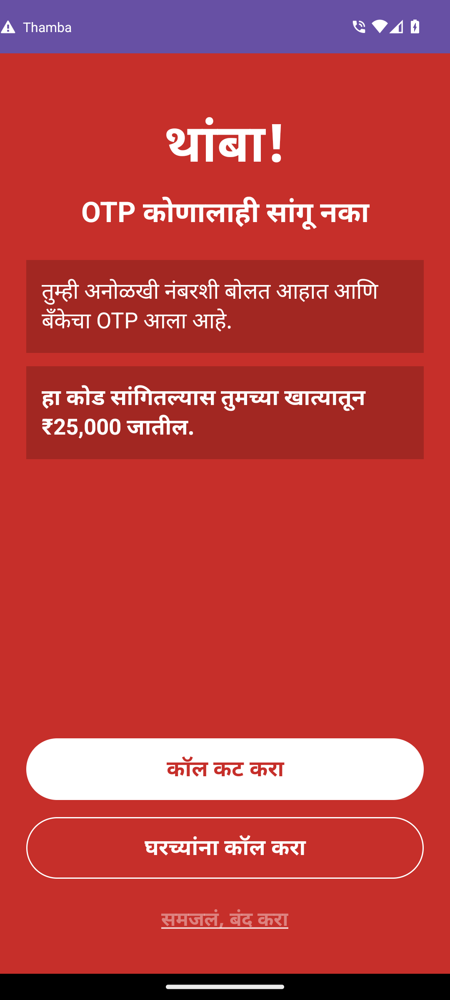
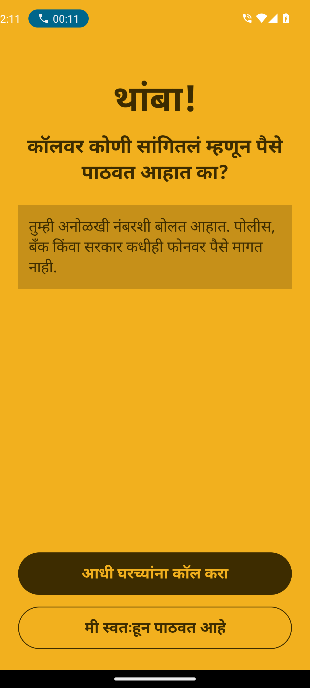
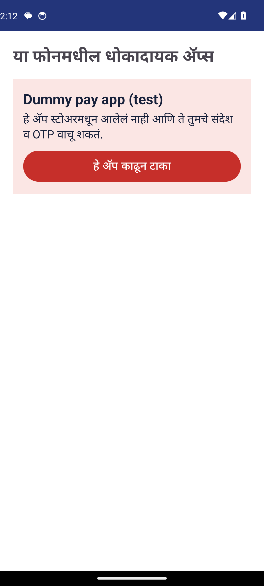
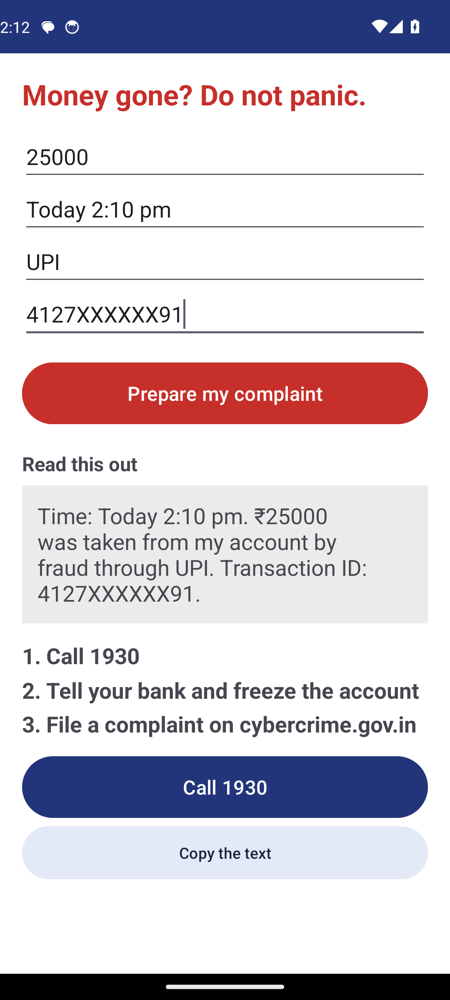
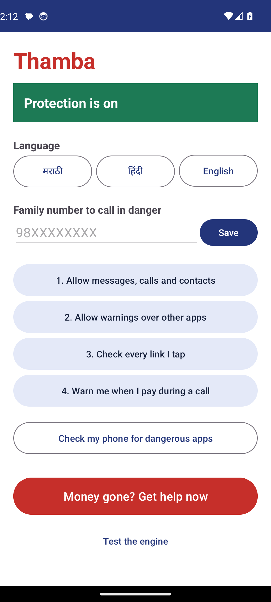

# Thamba (थांबा)

Thamba is an Android app that interrupts a person at the moment a phone fraud is about to succeed: when they are about to read out a one-time code, open a fake link, or act on a fake "official" message. "Thamba" means "stop" in Marathi.

It was built for Hack for a Social Cause, Viksit Bharat Young Leaders Dialogue 2027, under the theme Digital Safety & Cyber Fraud Awareness. Team: Bharat Innovates, Maharashtra.

## The problem

Cyber fraud in India mostly works by talking people into doing something themselves: sharing a code, tapping a link, installing a file. Spam-labelling apps judge the caller's phone number, so they wrongly flag genuine callers such as delivery staff and miss a fraudster using a new SIM. Awareness posters reach people long before or long after the call, not during it.

Thamba does not judge the caller. It watches for the dangerous moment on the phone and warns in the person's own language, on screen and aloud.

## What it does

| Guard | When it acts | What the person sees |
|---|---|---|
| Code guard | A bank, account or Aadhaar code arrives while a call is on with a number that is not in the contacts | A full-screen red warning, vibration and a spoken message saying what the code would do |
| Code guard, quiet | The same code arrives with no call, or it is a delivery code | A small notification explaining what the code is for |
| Link guard | Any link is tapped, in any app | Red for fakes and look-alikes, amber for hidden or risky addresses, a pass-through for the rest |
| Message guard | An SMS speaks like a bank or government office but comes from an ordinary mobile number | A warning notification that opens an amber screen |
| Payment guard | A payment app is opened during a call with a number that is not in the contacts | One amber question: "Are you sending money because someone on the call told you to?" The payment is never blocked |
| App guard | The person taps "Check my phone for dangerous apps" | A list of apps that read SMS without coming from an app store, and remote-access apps, each with a remove button |
| Money gone? | The person has already lost money | Four questions turned into a ready statement for helpline 1930 |

Languages: Marathi, Hindi and English.

## Status

This is a prototype. Be clear about what has and has not been proven.

| Part | State |
|---|---|
| Decision engine (Python) | Working, with 25 unit tests that pass |
| Android app: code, link and message guards, "Money gone?" helper | Builds and passed 11 checks on an Android 14 emulator. Not yet tested on a real phone |
| Android app: payment guard and app guard | Passed on the emulator with a stand-in payment app. Not yet tested on a real phone or with a real payment app |

Every test, with its result, is in [docs/TESTING.md](docs/TESTING.md). Every test, with its result, is in [docs/TESTING.md](docs/TESTING.md). Known limits are listed in [docs/FRAUD_COVERAGE.md](docs/FRAUD_COVERAGE.md).

## Screenshots

Taken on the emulator.

| Warning during an unknown call | Payment question | Home |
|---|---|---|
|  |  |  |

| App check | "Money gone?" helper |
|---|---|
|  |  |

## Screenshots

Taken on the emulator.

| Warning during an unknown call | Payment question | Home |
|---|---|---|
|  |  |  |

| App check | "Money gone?" helper |
|---|---|
|  |  |

## Repository layout

```
engine/    Python decision engine: the rules, sample messages and tests
android/   The Android app (Kotlin). It runs the Python engine on the phone
docs/      Architecture, fraud coverage, privacy and AI disclosure
```

## Run the engine tests

Needs Python 3.8 or newer. No packages to install.

```
cd engine
python -m unittest discover -s tests -v
```

Try it by hand:

```
cd engine
python -c "from thamba_engine import on_link; print(on_link('echallan.parivahan.in/pay'))"
```

## Build and run the app

You need Android Studio, an Android phone running Android 8.0 or newer, and Python 3.13 on the computer (the build uses it to package the engine).

1. Open the `android` folder in Android Studio and wait for the Gradle sync to finish.
2. Turn on USB debugging on the phone and connect it.
3. Press Run.
4. In the app, complete the four setup steps: allow the permissions, allow warnings over other apps, set Thamba to check links, and allow it to see which app is on screen during a call.
5. Enter a family number and choose a language.

If your Python version is not 3.13, change `version` in `android/app/build.gradle.kts` to match it. If `python` is not on your PATH, tell the build where it is:

```
cd android
gradlew assembleDebug -PbuildPython=C:/path/to/python.exe
```

The app file is written to `android/app/build/outputs/apk/debug/app-debug.apk`.

### Try it without waiting for a fraudster

- Open "Test the engine" at the bottom of the home screen, paste a message from `engine/samples/sms_samples.csv`, tick "A call is in progress", and check the verdict.
- For the real flow, have a friend whose number is not saved call you, and during the call trigger a login or payment code to your own phone.
- For the link guard, send yourself `https://echallan.parivahan.in/pay` in any chat and tap it.
- For the payment guard, open a payment app while on a call with a number that is not saved. Do not send any money.

## Privacy

The app reads incoming SMS, call state, the name of the app on screen during a call, and the list of installed apps, all on the phone, to make its decisions. It stores no messages and sends nothing to any server. See [docs/PRIVACY.md](docs/PRIVACY.md).

## Documents

- [Architecture](docs/ARCHITECTURE.md)
- [Testing](docs/TESTING.md)
- [Testing](docs/TESTING.md)
- [Fraud coverage and limits](docs/FRAUD_COVERAGE.md)
- [Privacy](docs/PRIVACY.md)
- [AI disclosure](docs/AI_DISCLOSURE.md)

## Licence

MIT. See [LICENSE](LICENSE).
