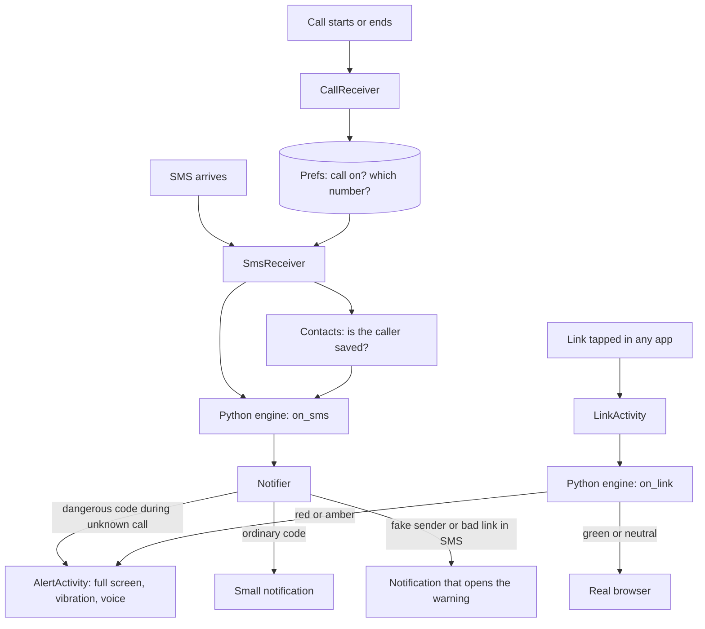

# Architecture

Thamba has two parts. A small Android app collects plain facts about what is happening on the phone. A Python engine turns those facts into a verdict. The app then shows or speaks the warning.

## Why two parts

- **The rules are easy to test.** The engine is ordinary Python with no Android code in it, so every rule is checked by unit tests on a laptop.
- **The same file runs in both places.** The app packages the `engine` folder with [Chaquopy](https://chaquo.com/chaquopy/), which runs Python inside an Android app. There is no second copy of the rules to keep in step.
- **Nothing needs a server.** Every decision is made on the phone.

## How a warning happens

## The engine

Folder: `engine/thamba_engine`

| File | Job |
|---|---|
| `otp.py` | Finds a one-time code in an SMS, sorts it as payment, login, identity, delivery or other, and reads the rupee amount |
| `links.py` | Gives a link a level: red, amber, green or neutral |
| `sender.py` | Flags a message that speaks like an authority but was sent from an ordinary mobile number |
| `apps.py` | Flags an installed app that reads SMS without coming from an app store, and remote-access apps |
| `payments.py` | Decides whether to ask a question when a payment app opens during a call |
| `engine.py` | The four entry points: `on_sms`, `on_link`, `on_app` and `on_payment` |
| `bridge.py` | The same calls returning JSON text, which is what the Android app uses |

### The code guard rule

A full-screen alert needs all three of these at once:

1. the SMS carries a code that can move money, open an account or prove identity
2. a phone call is in progress
3. the other person on the call is not in the contacts

If any one is missing, the person gets a small notification or nothing. This is what keeps delivery codes, and codes for the person's own payments, from raising an alarm.

### The link guard rule

In order: official government and banking suffixes are green; a link to an app file is red; a name that imitates a protected site without being it is red and the real site is offered; a bare number address is red; prize and offer bait is red; shortened, disguised, risky-ending or unencrypted links are amber; everything else is neutral and opens normally.

### The payment guard rule

One amber question is asked when a known payment app comes to the front of the screen while a call is on with someone who is not in the contacts. It is asked once per call, and the person can continue with one tap. A call with a saved contact never triggers it, so a family member asking for a payment over the phone is not interrupted.

### The app guard rule

An app is red when it was not installed by an app store and it asks to read SMS. A known remote-access app is amber wherever it came from. Apps that came with the phone are ignored.

## The Android app

Folder: `android/app/src/main/java/org/thamba/guard`

| File | Job |
|---|---|
| `MainActivity.kt` | Home and one-time setup |
| `CallReceiver.kt` | Records whether a call is on and with which number |
| `SmsReceiver.kt` | Runs when an SMS arrives and asks the engine for a verdict |
| `Contacts.kt` | Checks whether a number is a saved contact |
| `Engine.kt` | The single place where Kotlin calls Python |
| `Texts.kt` | Turns a verdict into words in the chosen language |
| `Notifier.kt` | Chooses between a full-screen warning and a notification |
| `AlertActivity.kt` | The warning screen, with vibration and speech |
| `Speaker.kt` | Text to speech |
| `LinkActivity.kt` | Receives tapped links and checks them |
| `Browser.kt` | Passes a checked link to the phone's real browser |
| `ComplaintActivity.kt` | The "Money gone?" helper |
| `CallWatchService.kt` | Payment guard: runs only during a call and checks which app is on screen |
| `Access.kt` | Checks whether the person has allowed Thamba to see the app on screen |
| `AppScanner.kt` | App guard: passes each installed app to the engine |
| `AppCheckActivity.kt` | Lists the dangerous apps found, each with a remove button |
| `TestActivity.kt` | A test bench that shows the raw verdict for typed input |

All on-screen text lives in `res/values` (English), `res/values-mr` (Marathi) and `res/values-hi` (Hindi).

## Design decisions

- **Judge the situation, not the caller.** No phone number is ever labelled or blocked.
- **The app never traps the person.** Every warning can be closed, and a payment or link can still go ahead.
- **Fail open.** If a check itself breaks, the link opens and the message is delivered as usual.
- **When unsure, treat the caller as unknown.** If the app cannot read the caller's number, it assumes the caller is not a contact.

## Planned next

- App guard that warns at the moment a dangerous app is installed, instead of only when the person asks for a check.
- App guard rule for apps that use the accessibility service to control the screen.
- More languages, each checked by a native speaker.
- An optional online safe-browsing check for links.
